<p align="center"></p>

<h1 align="center">PlexArr</h1>

<p align="center">
  Download from the Plex servers friends share with you, through Sonarr and Radarr.<br>
  A Newznab indexer plus a SABnzbd-like download client: no tunnels, no open ports, Usenet stays first.
</p>

<p align="center">
  <picture>
    <source media="(prefers-color-scheme: dark)" srcset="docs/screenshots/library-dark.png">
    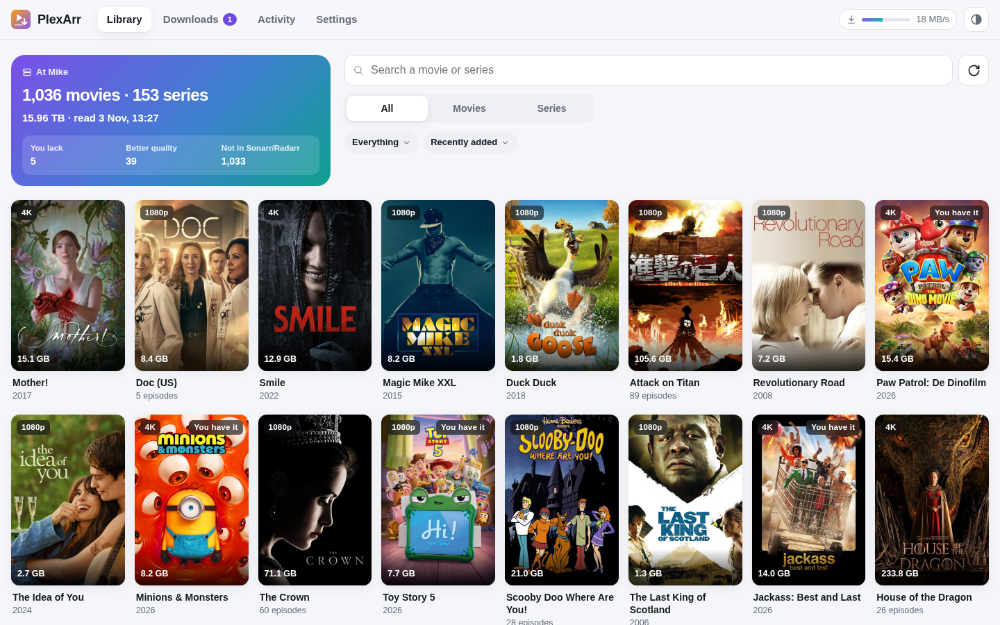
  </picture>
</p>

## What it does

- **Turns a friend's Plex server into an indexer.** PlexArr reads the libraries of the servers shared with your Plex account and answers Sonarr and Radarr searches by IMDb, TMDb or TVDB id. The file name becomes the release title, so Sonarr/Radarr see the source, resolution and group, and their quality profiles decide as usual. If a name lacks something, PlexArr fills it in from Plex's media info.
- **Downloads like a download client.** Sonarr/Radarr send the release to PlexArr as if it were SABnzbd. PlexArr downloads the original file from the friend's server (Plex's own download: resumable, optionally throttled), adds external subtitles, and puts it in the download folder. Sonarr/Radarr import it as usual.
- **Keeps Usenet first.** In *fallback* mode (the default) PlexArr only offers a release when a Usenet download failed, when the item has been missing for a while (24 hours by default), or when you fetch it yourself. *Auto search* (optional) asks Sonarr/Radarr every hour to search a few missing items a friend has. *Equal* mode offers everything and lets Sonarr/Radarr choose.
- **Shows the friends' libraries** with what you already have, what you lack, and what they have in better quality, with a button to fetch a movie or the missing episodes of a season.
- **Subtitles for Bazarr.** Bazarr can search the external subtitles on the friends' servers as a subtitle provider, next to OpenSubtitles and the rest.
- **Sets itself up in Sonarr and Radarr** with one click: an indexer and a download client, linked to each other.
- A setup wizard with *Sign in with Plex*, an activity log that explains why something was or wasn't offered, English and Dutch, light and dark, works well on a phone.

Your friend only has to allow downloads for your account when sharing the server (Plex → Users & Sharing → Allow downloads).

## Screenshots

| | Light | Dark |
|---|---|---|
| Library |  | 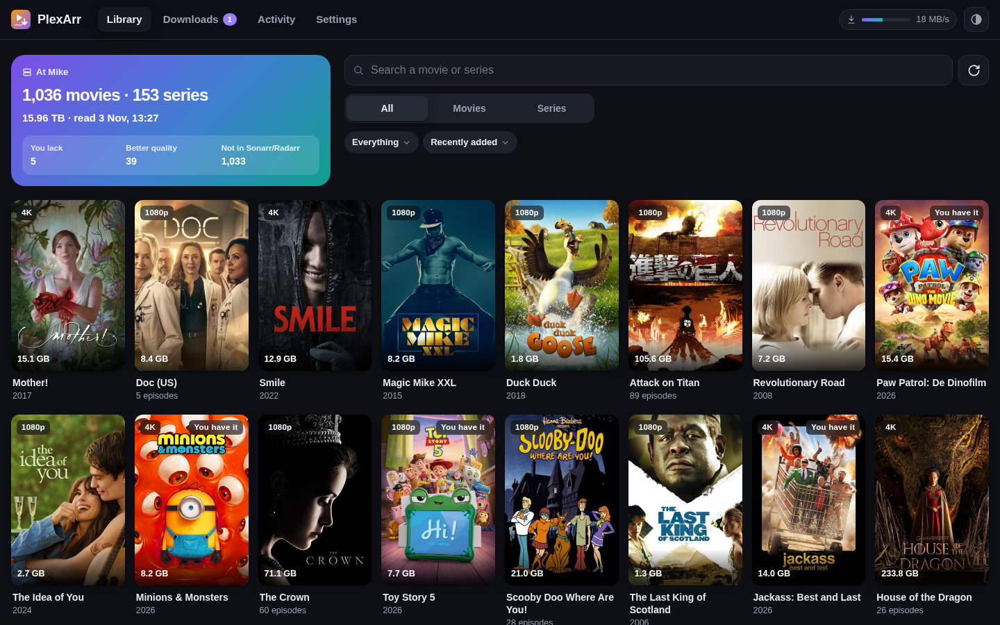 |
| Details | 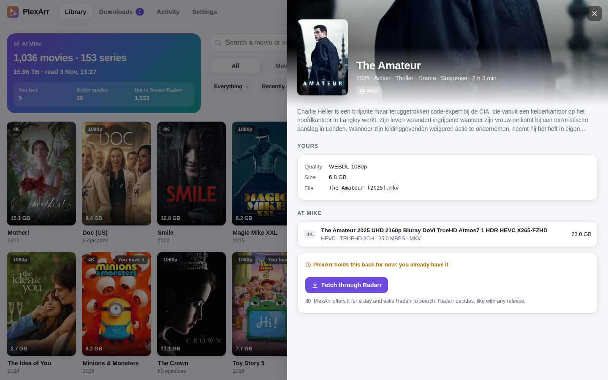 | 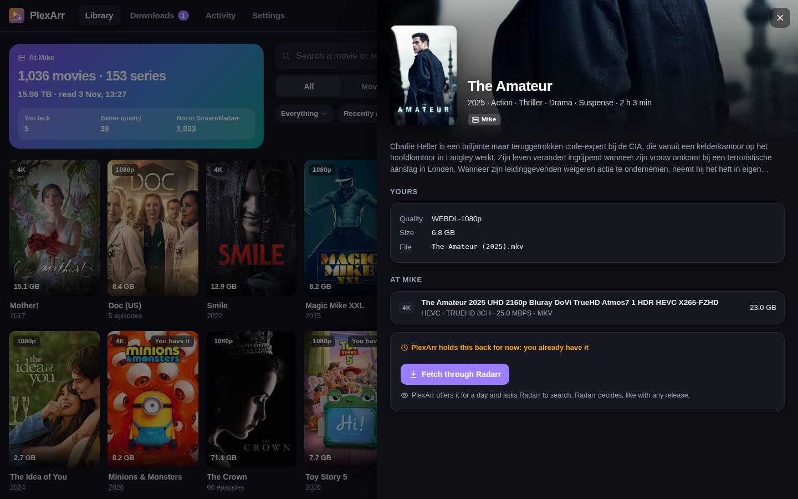 |
| Downloads | 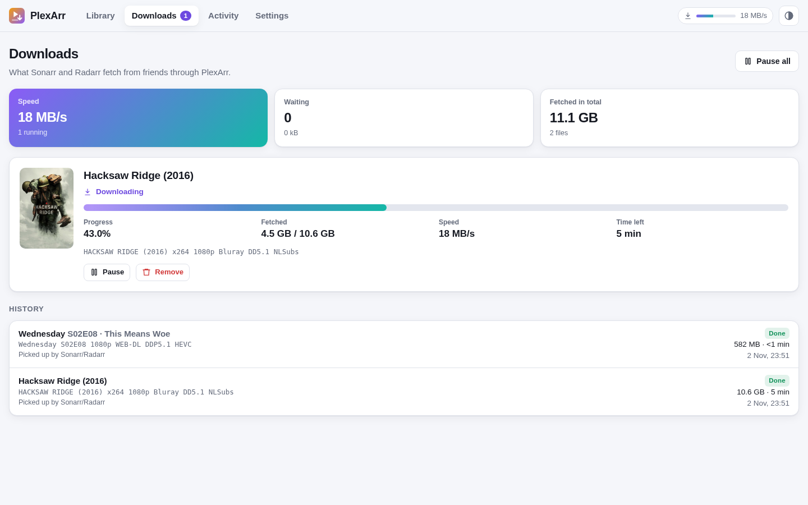 | 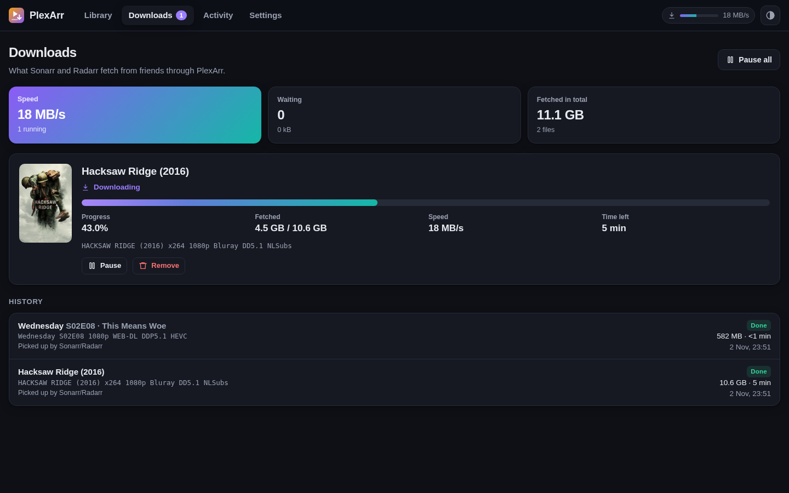 |
| Activity | 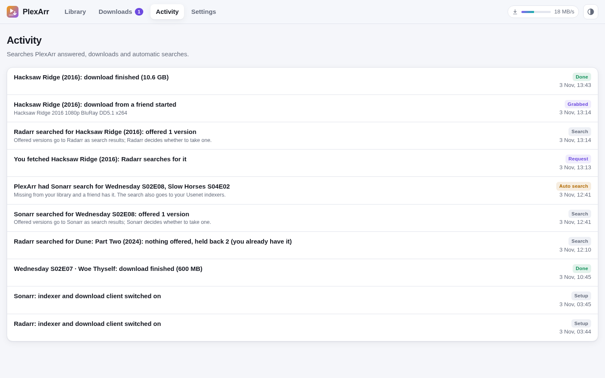 | 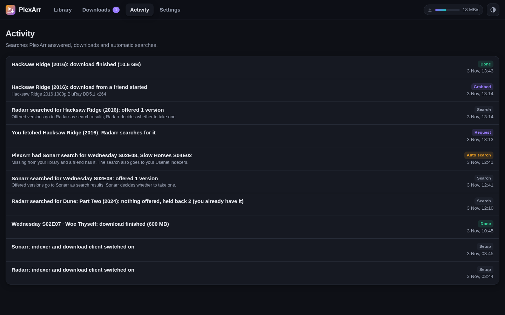 |
| Settings | 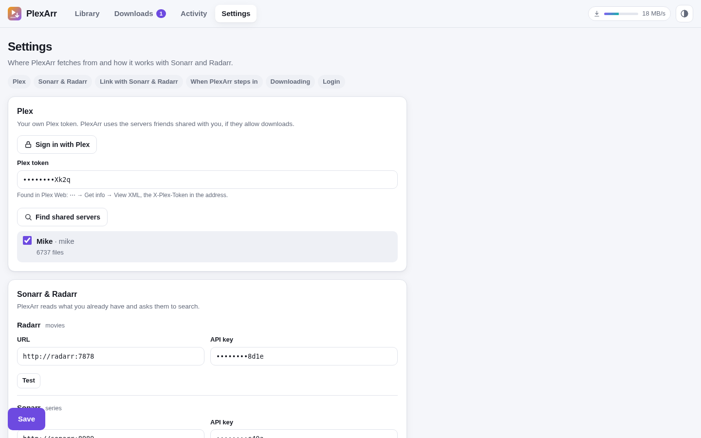 | 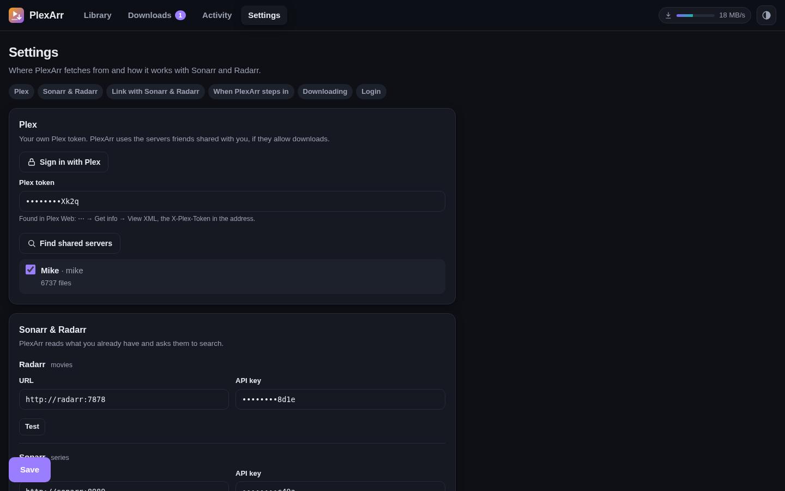 |
| Setup wizard | 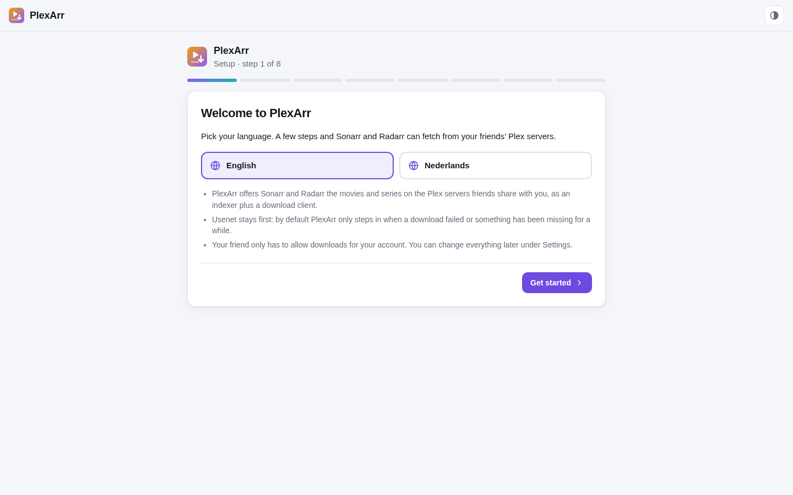 | 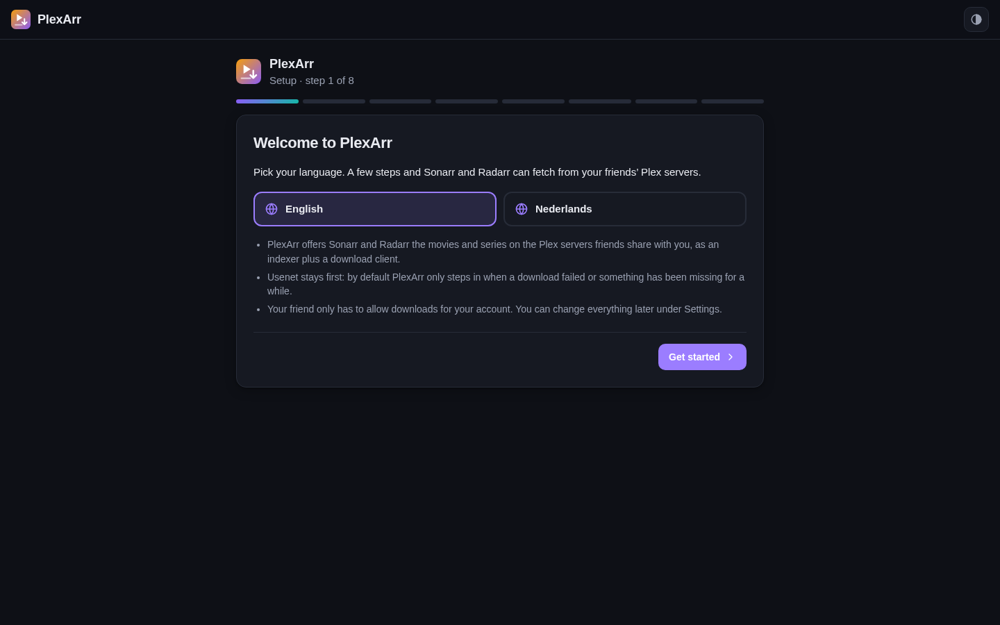 |
| Setup wizard: Plex | 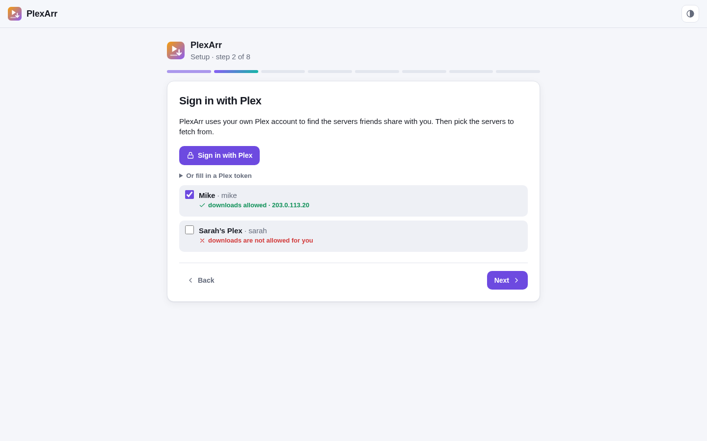 | 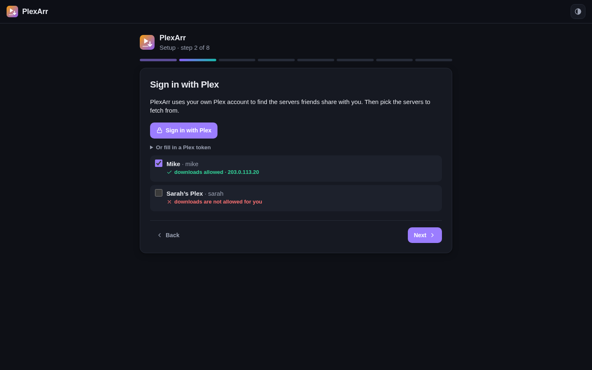 |

<p align="center">
  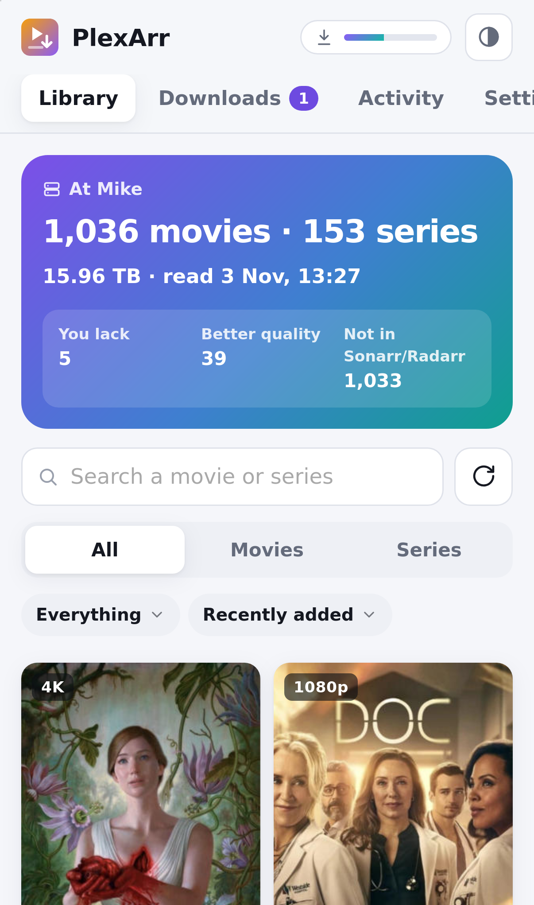
  &nbsp;
  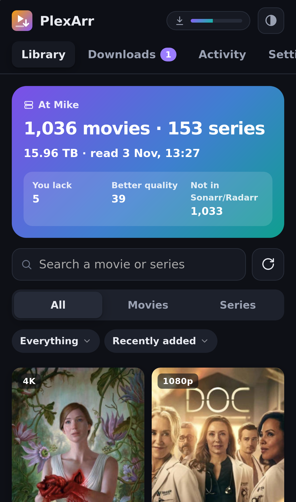
</p>

## Requirements

- Sonarr v4 and/or Radarr v5 or newer (one of them is enough).
- A Plex account that friends share their servers with, with downloads allowed for you. The friend's server needs a working direct connection (Remote Access); the Plex relay is too slow and is not used.
- Docker, and a download folder that PlexArr, Sonarr and Radarr all see **at the same path**.

## Installation

With Docker Compose, next to Sonarr and Radarr:

```yaml
services:
  plexarr:
    image: ghcr.io/rvanderend/plexarr:latest
    container_name: plexarr
    restart: unless-stopped
    user: "1000:1000"                 # the owner of your download folder
    ports:
      - "8080:8080"
    volumes:
      - ./plexarr:/data               # settings, the library index and the activity log
      - /srv/downloads:/downloads     # the same folder, at the same path, as in Sonarr and Radarr
    environment:
      TZ: Europe/Amsterdam
      DOWNLOAD_DIR: /downloads/plexarr
```

Run it with `docker compose up -d` and open `http://<host>:8080`. The **setup wizard** takes you through:

1. **Plex:** *Sign in with Plex* (or paste a Plex token), then pick the shared servers to fetch from. Each server shows whether downloads are allowed for you.
2. **Sonarr and Radarr:** their address and API key (Settings → General).
3. **Download folder:** PlexArr checks that Sonarr and Radarr see its download folder at the same path. If not, mount the folder the same way in their containers.
4. **Link:** one click adds a *PlexArr* indexer and a *PlexArr* download client to Sonarr and Radarr. *Active* means they search PlexArr on their own; *inactive* means interactive search only.
5. **When PlexArr steps in** (fallback or equal), and an optional **login**.

The images are built for amd64 and arm64. Environment variables:

| Variable | Default | |
|---|---|---|
| `DOWNLOAD_DIR` | `/downloads/plexarr` | Where finished downloads go. Sonarr/Radarr must see this folder at the same path. |
| `DATA_DIR` | `/data` | The database (settings, library index, downloads, activity). |
| `PORT` | `8080` | The web port. |

Everything else is set in the web UI.

### By hand, or with Prowlarr

Settings → *Link with Sonarr, Radarr & Bazarr* → *By hand* shows the details: a **Newznab** indexer with URL `http://plexarr:8080`, API path `/newznab/api` and the API key from that page, and a **SABnzbd** download client with host `plexarr`, port `8080`, URL base `sabnzbd` and the same API key. Give the indexer the PlexArr download client, so its releases don't go to your Usenet client (and the other way round).

### Bazarr

PlexArr also answers as a *Subsarr* server, a provider that Bazarr has built in. In Bazarr: Settings → Providers → **Subsarr**, with as base URL `http://plexarr:8080/subsarr/<API key>` (Settings → *Link with Sonarr, Radarr & Bazarr* shows the whole URL with a copy button). Bazarr sends no API key of its own, so the key is part of the URL; a new API key in PlexArr means a new URL in Bazarr.

Bazarr then searches the friends' servers by IMDb id (of the movie, or of the show for an episode), and by title when that finds nothing. Only **external text subtitles** (`.srt`, `.ass`, `.vtt`) can be offered: Plex doesn't hand out subtitles that are embedded in the video, and image subtitles (VobSub, PGS) are no use to Bazarr. Forced subtitles are left out, because Subsarr can't mark them as forced. Each result carries the file name of the friend's version, so Bazarr's score shows whether it is the same release as yours, and Bazarr's own sync can do the rest. The Activity page shows each search.

## How it works

1. Every 30 minutes (adjustable) PlexArr reads the libraries of the chosen servers through Plex's API and keeps an index: per file the ids, resolution, codecs, size and the file name. Multi-part files (CD1/CD2) are skipped.
2. When Sonarr or Radarr search, PlexArr answers with the matching files as releases. In fallback mode it checks Sonarr/Radarr first: a movie or episode you already have, that isn't monitored or isn't released yet is held back, and so is one that hasn't been missing long enough. A recent failed download, or a fetch from the web UI, makes it eligible right away. The Activity page shows each search with what was offered and why the rest was held back.
3. Sonarr/Radarr grab a release the usual way and send it to PlexArr's SABnzbd API. PlexArr downloads the file over a direct connection to the friend's server, with resume after an interruption and an optional speed limit, plus any `.srt`/`.ass` subtitles next to it.
4. The finished file lands in `DOWNLOAD_DIR/<category>`; Sonarr/Radarr import it and PlexArr removes it from its history when they ask.

**Auto search** (fallback mode, off by default): Sonarr and Radarr only search when something is added or a download fails, so items Usenet never had would stay missing. Once an hour PlexArr asks them to search a few missing items a friend has (3 by default), only when the quality profile would take the friend's version, and the same item again after 7 days at the earliest. These searches also go to your Usenet indexers.

## Updating

```bash
docker compose pull plexarr && docker compose up -d plexarr
```

`latest` follows the releases; `0.3` stays on 0.3.x; `main` is the newest, untested state. What changed is in [CHANGELOG.md](CHANGELOG.md).

## Troubleshooting

- **"doesn't see this folder" in the wizard.** Sonarr/Radarr look for PlexArr's download folder at the same path. Mount the same host folder at the same path in all three containers, or add a *Remote Path Mapping* in Sonarr/Radarr (Settings → Download Clients).
- **A server says "downloads are not allowed for you".** The friend has to allow downloads for your account (Plex → Users & Sharing → your name → Allow downloads).
- **A server is "not reachable" or has no direct connection.** PlexArr only uses direct connections. The friend's Remote Access must work; the relay is not used.
- **Sonarr/Radarr can't reach the indexer when linking.** Fill in how they reach PlexArr under *How Sonarr/Radarr reach PlexArr* (for example `http://192.168.1.10:8080` if they don't run in the same Docker network), and link again.
- **Nothing is offered.** The Activity page shows why for each search: you already have it, it isn't monitored, it isn't released yet, or it hasn't been missing long enough (fallback mode). *Fetch through Radarr/Sonarr* in the details overrides that for a day.

## Security and good manners

- The web UI has an optional login (one user, scrypt-hashed password, signed session cookie). Without it, anyone on your network can use PlexArr and the Plex account behind it, so either turn it on or put PlexArr behind a reverse proxy with its own login. Sonarr, Radarr and other tools use the API key.
- Your Plex token and the Sonarr/Radarr API keys are stored in the database in `/data` and are only shown masked in the UI.
- Downloads go over your friend's upload. Use the speed limit and the number of downloads at the same time (Settings → Downloading) so their own streams keep working, and keep the fallback mode if Usenet usually has what you need.

## Development

```
app/main.py        FastAPI routes, login, settings, setup wizard
app/plex.py        plex.tv (shared servers, sign-in), connections and the library index
app/releases.py    release titles and when a file is offered (fallback/equal)
app/newznab.py     the Newznab API for Sonarr, Radarr and Prowlarr
app/sab.py         the SABnzbd API for Sonarr and Radarr
app/downloader.py  downloads from the friend's server: resume, speed limit, subtitles
app/arr.py         Sonarr/Radarr: what you have, failed downloads, linking, folder check
app/sweep.py       auto search
app/static/        web UI: vanilla JS modules, no build step (i18n.js holds the texts)
```

To run it from the source: `pip install -r requirements.txt`, then `DATA_DIR=./data DOWNLOAD_DIR=./downloads uvicorn app.main:app --reload --port 8080`.

## License

PlexArr is **source-available** under the [PolyForm Strict License 1.0.0](LICENSE): you may use it for any noncommercial purpose, including at home. You may not distribute it or publish modified versions. Development happens in this repository: ideas, bug reports and pull requests are welcome, see [CONTRIBUTING.md](CONTRIBUTING.md).

PlexArr uses [FastAPI](https://fastapi.tiangolo.com), [Uvicorn](https://www.uvicorn.org) and [httpx](https://www.python-httpx.org); those keep their own licenses. PlexArr is not affiliated with Plex, Sonarr or Radarr.
